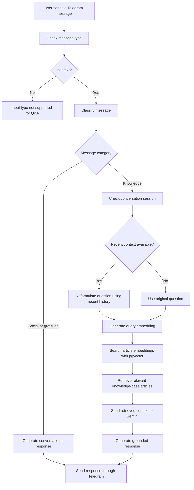

# Subdistrict Information Chatbot (Kelurahan Info Bot)

An AI-powered Telegram chatbot that helps people in Indonesia access local administrative information through natural-language questions. The project combines a Python backend, a PostgreSQL knowledge base, vector similarity search, and the Google Gemini API.

> **Project status:** In development. This repository is a work in progress, and features may change as the system evolves.

## Overview

Finding accurate information about local administrative procedures can require citizens to contact an office directly or search through multiple sources. This project explores a more accessible approach: users can ask questions in Indonesian through Telegram and receive responses grounded in a curated administrative knowledge base.

The system is intended to be reusable in different kelurahan contexts. However, **multi-kelurahan data separation is not implemented yet**. The current database does not associate articles with a kelurahan identifier, and retrieval is not scoped to a selected kelurahan.

## Key Features

- **Telegram chatbot:** Receives messages through the Telegram Bot API using long polling.
- **Text-message question answering:** Detects incoming message types; the current question-answering flow supports text messages only.
- **Message classification:** Classifies text as a knowledge question, a social message (such as a greeting), or gratitude.
- **Conversation-context handling:** Uses recent conversation history to reformulate follow-up questions when context is relevant.
- **Embedding generation:** Converts the search query into a vector using the Gemini embedding API.
- **Vector retrieval:** Searches article embeddings in PostgreSQL with pgvector using cosine distance.
- **Grounded AI responses:** Sends retrieved knowledge-base content to Gemini to generate an answer based on the available context.
- **Flask REST API:** Exposes article endpoints to retrieve, create, update, and delete knowledge-base articles.

## Technology Stack

| Component | Technology |
|---|---|
| Programming language | Python 3.14.4 Supported |
| Backend framework | Flask |
| Database | PostgreSQL 14.24 (development environment) |
| Database driver | Psycopg (`psycopg[binary]`) |
| Vector search | pgvector 0.8.7 (development environment) |
| LLM and embedding API | Google Gemini API (`google-genai`) |
| Chat platform | Telegram Bot API |
| HTTP client | Requests |
| Environment configuration | python-dotenv |

PostgreSQL and the pgvector extension must be installed and configured separately. The versions above describe the current development environment; compatibility with other versions has not yet been verified.

## How It Works

The current Telegram question-answering flow works as follows:

1. A user sends a message to the Telegram bot.
2. The bot checks the incoming message type. The question-answering flow currently supports text messages only.
3. The text is classified as a social message, gratitude, or a knowledge question.
4. For a knowledge question, the system retrieves or creates a conversation session for the Telegram chat.
5. If the session is active and recent, the system loads the latest three question-and-answer pairs and uses them to reformulate a context-dependent follow-up question. Otherwise, it uses the user's original question.
6. The resulting query is converted into an embedding.
7. PostgreSQL with pgvector compares the query embedding with stored article embeddings using cosine distance and retrieves relevant articles.
8. The retrieved articles are passed to the Gemini language model as context.
9. Gemini generates a response grounded in the supplied knowledge-base context.
10. The bot sends the response back to the user through Telegram.

### Retrieval and response flow



### Conversation sessions and context

The current implementation stores conversation sessions and knowledge-question history in PostgreSQL:

- A session is associated with a Telegram `chat_id` and has an `active` or `ended` status.
- For a recent active session, the application retrieves up to the latest three question-and-answer pairs to help interpret a follow-up question.
- The inactivity threshold in the current code is two minutes. When a later knowledge message detects that the last stored conversation entry is older than this threshold, the code ends the session and deletes that session's rows from `context_history` before starting a new context cycle.
- The session record itself is not deleted by that context-history cleanup.

This describes the current code behavior, not a complete data-retention policy. Review and formalize retention, deletion, and user-notice policies before using the bot with real users at scale.

## Project Structure

```text
kelurahan-info-bot/
├── src/
│   ├── application.py       # Flask application and article REST API
│   ├── classifier.py        # Telegram message type and intent classification
│   ├── connection_dbms.py   # Database connection
│   ├── context_sessions.py  # Conversation sessions and context history
│   ├── embeddings.py        # Query embedding and vector similarity functions
│   ├── llm.py               # Gemini language-model integration
│   ├── main.py              # Telegram bot entry point
│   ├── migration.py         # Experimental JSON-to-database testing utility
│   ├── models.py            # Data models
│   ├── search.py             # Prompt construction and retrieval helpers
│   ├── storage.py            # Database access functions
│   ├── task.py               # Task handling
│   └── telegram_api.py      # Telegram API integration
├── data/
│   ├── knowledge.json       # JSON knowledge data used for testing/migration
│   ├── schema.sql           # Database table/column definitions
│   └── seed.sql             # SQL statements for changing or populating table data
├── .gitignore
├── requirement.txt
└── README.md
```

The local virtual environment (`venv/`) and Telegram runtime-state file (`data/telegram_state.json`) are local runtime files and should not be committed. The repository's `.gitignore` excludes them, along with `.env` and Python cache files.

## Getting Started

### Prerequisites

Install and configure the following before running the project:

- Python 3.14.4
- PostgreSQL 14 or a compatible version (developed with PostgreSQL 14.24)
- pgvector for PostgreSQL (developed with pgvector 0.8.7; manual installation is required)
- A Telegram bot token from [BotFather](https://core.telegram.org/bots#botfather)
- A Google Gemini API key

### 1. Clone the repository

```bash
git clone https://github.com/handzhaff-code/kelurahan-info-bot.git
cd kelurahan-info-bot
```

### 2. Create and activate a virtual environment

On Windows:

```bash
py -m venv venv
venv\Scripts\activate
```

On macOS or Linux:

```bash
python3 -m venv venv
source venv/bin/activate
```

### 3. Install Python dependencies

The dependency file in the current repository is named `requirement.txt`:

```bash
python -m pip install -r requirement.txt
```

On Windows, `py -m pip install -r requirement.txt` can also be used.

The current dependency list is:

```text
google-genai
python-dotenv
requests
psycopg[binary]
flask
pgvector
```

### 4. Configure environment variables

Create a `.env` file in the repository root and provide your own credentials and database connection details:

```env
# API keys
GEMINI_API_KEY=
TELEGRAM_BOT_TOKEN=

# Database references
DB_HOST=
DB_PORT=
DB_NAME=
DB_USER=
DB_PASSWORD=
```

Never commit the real `.env` file or expose API keys, bot tokens, or database credentials in source code or public commits.

### 5. Prepare the PostgreSQL database

Install PostgreSQL and pgvector manually, create the database configured in `.env`, and ensure the vector extension is available in that database. If it is not enabled yet, execute:

```sql
CREATE EXTENSION IF NOT EXISTS vector;
```

Use the SQL files for direct database maintenance:

- `data/schema.sql` contains database structure statements, such as creating or changing tables and columns.
- `data/seed.sql` contains SQL statements for populating or changing table data.

Review the SQL statements and execute the relevant file against the intended database. For example:

```bash
psql -U <DB_USER> -d <DB_NAME> -f data/schema.sql
psql -U <DB_USER> -d <DB_NAME> -f data/seed.sql
```

The exact effects depend on the SQL statements currently present in each file. Back up important data before applying schema or data changes.

### 6. Knowledge-base data entry and migration

The intended data-management workflow is to use a future frontend admin panel that sends JSON requests to the Flask API in `src/application.py`. The API currently exposes article retrieval, creation, update, and deletion routes, but the frontend admin panel and API authentication/authorization have not been implemented.

`src/migration.py` is a separate **experimental utility for bulk JSON data used during testing**. It defines helper functions to load `data/knowledge.json` and insert category/article records into PostgreSQL. It is not the planned production data-entry workflow. Also, the current migration insert writes the article's ID, category, question, keywords, and answer fields; it does not populate the article embedding column. The module's `__main__` block is currently empty, so running `python src/migration.py` by itself does not execute the migration.

For vector retrieval to work, the article embedding data must also be available in the database. The migration utility described above does not generate or insert those embeddings.

### 7. Run the Telegram bot

From the repository root, run:

```bash
python src/main.py
```

On Windows, `py src/main.py` can also be used.

### 8. Run the Flask API

The Flask application has a direct Python entry point in `src/application.py`. From the repository root, run:

```bash
python src/application.py
```

On Windows, `py src/application.py` can also be used. The current source starts Flask with debug mode enabled; this is for local development only. Do not use Flask's built-in development server as a production deployment server.

## REST API

The current routes defined in `src/application.py` are:

| Method | Endpoint | Description |
|---|---|---|
| `GET` | `/api/articles` | Retrieve all articles. |
| `GET` | `/api/articles/{article_id}` | Retrieve one article by ID. |
| `POST` | `/api/articles` | Create an article using a JSON request body. |
| `PATCH` | `/api/articles` | Update article data using a JSON request body. |
| `DELETE` | `/api/articles/{article_id}` | Delete an article by ID. |

The `PATCH` route is defined at the collection path and receives update data in the request body; it does not include the article ID in the URL. The exact JSON fields are determined by the database functions called by the application.

Authentication and authorization have not been implemented. Do not expose the API publicly or use it with untrusted clients until appropriate access controls and input validation are added.

## Privacy and Data Handling

For knowledge questions, the application stores the Telegram chat identifier in the `sessions` table and stores the user's question, the generated answer, and a creation timestamp in `context_history`. Up to the latest three question-and-answer pairs are loaded for follow-up question reformulation. When a later knowledge message detects more than two minutes of inactivity, the current code deletes the corresponding `context_history` rows and marks the session as ended; the session record remains.

The project also uses a local Telegram runtime-state file at `data/telegram_state.json`. This file is excluded from version control. Avoid sending sensitive personal information to the bot, and establish a clear retention and deletion policy before collecting real users' conversations.

## Important Disclaimer

This chatbot is an informational aid and is not an official government communication channel. Administrative requirements and procedures may change, and AI-generated responses may be incomplete or outdated. Users should confirm important information directly with the relevant kelurahan office.

## Current Limitations

- Text is the only Telegram message type currently supported by the question-answering flow.
- Multi-kelurahan data modeling, data separation, and kelurahan-scoped retrieval have not been implemented.
- The frontend admin panel is planned but not implemented.
- Flask API authentication and authorization are not implemented.
- The JSON migration utility is experimental and does not populate article embeddings.
- A minimum supported Python version and a production deployment configuration have not yet been established.

## Roadmap

- Develop a frontend admin panel for knowledge-base management through the Flask API.
- Add authentication and authorization for administrative API access.
- Implement multi-kelurahan data modeling and retrieval isolation.
- Establish a reliable article-embedding generation and update workflow.
- Expand supported Telegram input types and improve validation and error handling.
- Define production deployment, logging, and conversation data-retention practices.

## License

No license has been selected for this repository yet. Until a license is added, the project should be treated as having no explicit permission for reuse, distribution, or modification.
